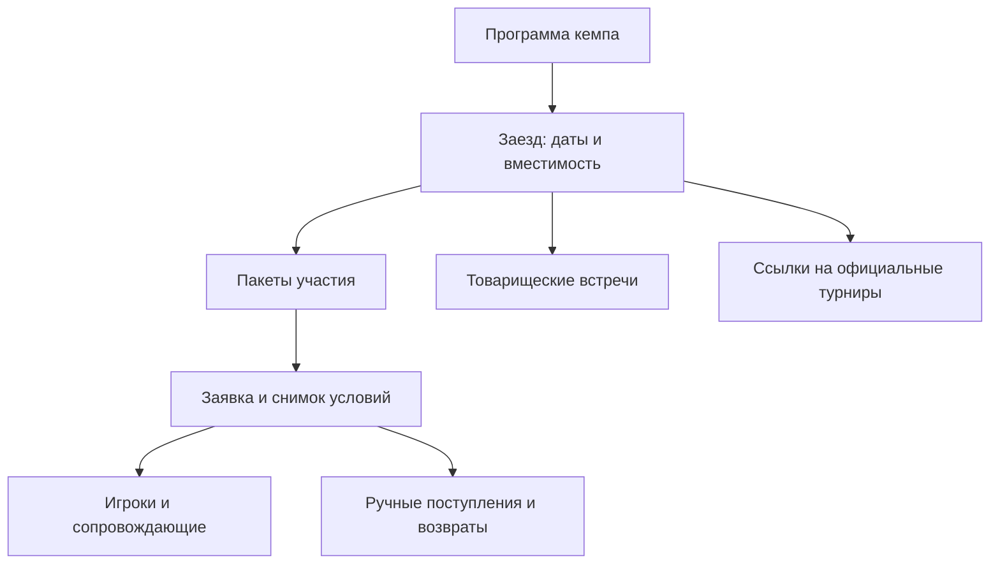

# Собственные кемпы TennisFan

Реализована первая рабочая версия: TennisFan организует программы и принимает заявки на свои заезды. Сторонних организаторов и размещения чужих предложений нет.

## Структура

- `Camp` — публичное описание программы, тренеры, обложка и подготовка.
- `CampSession` — конкретные даты, площадка, возраст, спортивная вместимость, условия и координатор.
- `CampPackage` — предложение конкретного заезда с ценой за игрока, валютой и составом. Пустая цена означает «по запросу»; нулевая — бесплатный пакет.
- `CampApplication` — контактное лицо, необязательная связь с аккаунтом, статус, согласованная сумма и неизменяемый снимок предложения при подаче.
- `CampParticipant` — взрослый игрок, ребёнок или сопровождающий; группа и необязательный профиль игрока назначаются командой.
- `CampPayment` — ручной финансовый журнал со знаковыми суммами. Положительная сумма — фактическое поступление, отрицательная — возврат. Это не операция ЮKassa.
- `CampExpense` — план расходов заезда, отдельно по валютам.
- `CampGame` — журнал товарищеских встреч. Эти записи не являются официальными матчами и не запускают расчёт рейтинга.
- `CampTournament` — ссылка на существующий турнир платформы. Его сетка, матчи и расчёт рейтинга остаются в турнирном модуле.

## Экраны

| Адрес | Назначение |
| --- | --- |
| `/camps/` | Собственные программы; фильтр аудитории и ближайшие даты |
| `/camps/<slug>/` | Программа, тренеры, пакеты, даты, включённые услуги и условия |
| `/camps/sessions/<id>/apply/` | Гостевая или авторизованная заявка с несколькими участниками |
| `/camps/applications/<uuid>/` | Закрытая страница собственной заявки |
| `/camps/my/` | Мои заявки и поездки, включая восстановленные гостевые |
| `/camps/recover/` | Запрос одноразового доступа по email |
| `/camps/access/<token>/` | Подтверждение доступа без входа в аккаунт |
| `/camps/applications/<uuid>/cancel/` | Запрос участника на отмену всей заявки |
| `/camps/team/` | Заезды команды |
| `/camps/team/sessions/<id>/` | Набор, состав, расчёты по валютам, расходы и игры |
| `/camps/team/applications/<uuid>/` | Подтверждение и согласование суммы, журнал поступлений/возвратов |
| `/camps/team/sessions/<id>/export/` | Служебный CSV состава поездки |
| `/camps/sessions/<id>/games/` | Журнал встреч для подтверждённых участников и команды |

В главном меню добавляется «Кемпы», в меню аккаунта — «Мои кемпы». Администратор может изменить положение пункта обычным редактором навигации.

## Как запустить первый набор

1. Применить миграции стандартным процессом проекта: `venv/bin/python manage.py migrate`.
2. В Django admin открыть **Кемпы TennisFan → Программы кемпов → Добавить**. Заполнить программу, выбрать тренеров и сохранить.
3. В сохранённой программе нажать «Добавить заезд». Указать даты, вместимость, возраст, площадку, условия оплаты/отмены и контакт координатора.
4. В том же редакторе добавить пакеты участия, при необходимости план расходов и ссылку на существующий официальный турнир.
5. Установить состояние заезда «Идёт набор», а у программы — «Опубликован».
6. Открыть публичную страницу и проверить фактические условия перед публикацией ссылки участникам.

Настоящие даты, цены, фотографии и договорные условия не создаются автоматически. Демо находится исключительно на изолированном тестовом стенде.

Координатор — активный сотрудник с правом `camps.change_campapplication`. Сотрудники с этим разрешением видят все заезды и обращения раздела. Это роль общей команды TennisFan, не изолированные кабинеты разных организаций.

## Подача и подтверждение

- Просмотр и первичная заявка доступны без входа.
- Указываются контакты взрослого, пакет и состав поездки. Форма допускает до 12 человек; требуется хотя бы один игрок.
- Проверяются телефон, email, согласие, возрастные границы заезда, роль ребёнка и доступность пакета.
- Дополнительные участники добавляются кнопкой, без перезагрузки. Ошибки показываются у полей и сохраняют ввод.
- Повторная отправка одной формы не создаёт дубль заявки. Ключ привязан к браузерной сессии и заезду.
- Набор повторно проверяется при сохранении; открытая до закрытия набора форма не обходит ограничение.
- По умолчанию подача заявки резервирует места для всех игроков без предоплаты до конца дня начала заезда. В настройках можно отключить автоматическую бронь. Сопровождающие не расходуют спортивные места. Если мест не хватает для всей группы, заявка целиком попадает в лист ожидания.
- Свободные места учитывают подтверждённых игроков и действующие временные брони. Истёкшая бронь перестаёт занимать места немедленно, даже до запуска фоновой команды. Выдача и продление брони, истечение и подтверждение блокируют одну строку заезда в транзакции. Подтверждение исключает собственную бронь из занятых мест и снимает её срок. Проверяется вместимость для всей группы и наличие согласованной стоимости.
- Сопровождающие не занимают спортивные места. Вместимость отеля на этом этапе подтверждает команда вручную.
- Сумма за всю заявку согласуется отдельно: цена пакета не умножается автоматически на сопровождающих.
- Лист ожидания не занимает мест. Автоматического перевода в подтверждённые нет.
- Отмена заявки освобождает место, но не создаёт вымышленный возврат. Возврат фиксируется отдельной проводкой после фактической операции.

Переходы: новая → связались / согласованы условия / подтверждена / лист ожидания / отменена. Из листа ожидания можно согласовать и подтвердить участие. Подтверждённая заявка → завершена либо отменена. Завершение возможно после окончания заезда; отменённые и завершённые заявки не переоткрываются. Для новой поездки подаётся новая заявка.

## Расчёты

- Валюта заявки фиксируется из пакета при подаче.
- Поступления и возвраты записываются сотрудником через экран заявки.
- Повтор операции с тем же ключом не создаёт второй записи.
- Нулевая проводка и возврат сверх полученных денег запрещены.
- Журнал нельзя редактировать или удалять через обычную админку. Ошибка исправляется обратной проводкой с пояснением.
- Согласованные суммы, полученные деньги и расходы показаны отдельно по валютам. Автоматической конвертации и расчёта прибыли нет.
- Онлайн-оплата, банковская сверка, чеки и автоматические возвраты в эту версию не включены.

## Матчи и рейтинг

Товарищеская игра допускает только двух разных подтверждённых игроков этого заезда; сопровождающий не может стать соперником. Журнал поддерживает свободный формат счёта для учебных и укороченных встреч.

Он намеренно отделён от `tournaments.Match`: существующий движок имеет автоматические побочные эффекты для рейтинга и официальных счётчиков. Для учебных игр их исключает сама структура данных. Такие игры доступны в журнале заезда и не включены в общую историю официальных личных встреч и процент побед профиля.

Официальный турнир создаётся обычными средствами платформы и связывается с заездом. Игроки регистрируются и результаты подтверждаются по существующим правилам турниров. Связь не копирует матчи, не регистрирует всех участников кемпа автоматически и не меняет алгоритм рейтинга. Зачётность следует объявить в регламенте до начала соревнования.

Детские товарищеские игры также не затрагивают детский или взрослый рейтинг. Связь с отдельным турнирным модулем детской лиги и управление детскими спортивными документами в эту версию не входят.

## Приватность и уведомления

- Заявку видит создавший её аккаунт либо исходная браузерная сессия гостя. UUID сам по себе не даёт доступ.
- Совпадение введённого email с аккаунтом не связывает заявку с этим аккаунтом.
- Гость может восстановить доступ на другом устройстве через `/camps/recover/`. Одноразовая ссылка отправляется на email исходной заявки, действует 30 минут и подтверждается POST-запросом с CSRF. Один GET не расходует ссылку. Доступ выдаётся только исходным гостевым заявкам и только в текущей сессии; вход в аккаунт и привязка аккаунта не выполняются.
- Журнал встреч закрыт от посторонних. Для детей в нём используются нейтральные подписи вместо имён.
- Внутренние заметки и размещение не выводятся на странице участника.
- Служебные страницы отключают кэширование и индексацию. CSV доступен команде; значения, похожие на формулы, экранируются.
- События `camp.application_submitted` и `camp.application_updated` зарегистрированы в общем центре уведомлений. Новая заявка приходит назначенному координатору; при отсутствии координатора — активным суперадминистраторам. Авторизованный заявитель получает своё уведомление.
- Центр использует существующие согласия и политики email/ЛК/push. Гостю отправляется письмо через тот же почтовый адаптер после фиксации заявки; ошибки транспорта логируются. Календарные напоминания подключены к существующему cron. Письма о новой заявке и смене статуса по-прежнему отправляются после commit; их транспортные ошибки логируются.

## Дизайн

Раздел использует общий тёмно-зелёный фон и золотые акценты TennisFan без отдельной светлой подложки. Публичная страница использует крупную типографику, спокойные карточки, отдельные пакеты и явный следующий шаг. Фотографии тренеров фиксированы квадратом 72×72 px на широком экране и 56×56 px на мобильном с обрезкой без искажения пропорций. На узких экранах колонки перестраиваются в одну, а таблицы прокручиваются внутри своего контейнера. Условия и второстепенная информация раскрываются по запросу. Полупрозрачный навигатор отделён от контента; формы имеют видимый фокус, подписи и ошибки, цели нажатия от 44 px. Учитываются reduced motion, reduced transparency и increased contrast.

## Проверка

- Интеграционные проверки находятся в `tests/integration/camps/`.
- Проверяются приватность, гостевые заявки, повторы, возраст, закрытый набор, вместимость, отмена, ручные проводки, возвраты, CSV и неизменность рейтинга.
- Миграции проверяются на отдельной временной SQLite-базе.
- Блокировки `select_for_update` защищают подтверждение на PostgreSQL; SQLite не обеспечивает такую же блокировку строк.
- `tests.support.camp_browser_settings` и `tests.support.camp_browser_seed` предназначены только для локального стенда. Почта хранится в памяти, реальные платежи не вызываются, демо не добавляется в рабочую базу.

## Восстановление доступа

На странице «Мои кемпы» есть ссылка восстановления. Ответ одинаков для известного и неизвестного email. Запросы ограничены по адресу отправителя (60/час) и email (2/10 минут); email в ключах кэша хранится как HMAC. Кэш должен быть общим для процессов, чтобы лимит был общим для всех web-worker.

В БД хранится только SHA-256 случайного 256-битного токена, срок и список исходных заявок. GET показывает отдельный экран без аналитики, с `no-referrer` и запретом кэширования. POST одноразово отмечает токен использованным и обновляет ключ сессии. Изменение email или привязка заявки к аккаунту после выдачи письма исключает такую заявку из выдаваемого доступа. Тело письма и ошибки с секретом скрыты в `OutboundEmail`; сам секрет не попадает в ЛК/push. В одном письме восстанавливается до 100 последних гостевых заявок адреса.

## Запрос на отмену

Участник открывает свою заявку и нажимает «Запросить отмену поездки». Указывает причину и явно подтверждает, что обращение относится ко всему составу заявки. Для изменения части состава предлагается обратиться к координатору.

Пока запрос ожидает решения, подтверждённое участие и его места сохраняются; временная бронь истекает в обычный срок и не продлевается запросом. Плановые напоминания приостановлены. Открытый запрос может быть только один, повторные POST не создают дубль. Координатор видит выделение в списке заезда, фильтр ожидающих запросов и историю в рабочем экране заявки.

Одобрение меняет статус участия на «Отменена» и освобождает спортивные места. Отклонение оставляет участие без изменений; ответ обязателен и виден участнику. История сохраняется, после отклонения можно подать новое обращение. Денежных операций ни одно решение не создаёт. При прямой отмене заявки координатором открытый запрос также закрывается. Подтвердить или завершить заявку с ещё не рассмотренным запросом нельзя.

## Плановые напоминания

Команда `venv/bin/python manage.py send_camp_reminders` включена в `CRONJOBS` на 15-ю минуту каждого часа по существующей конфигурации сервера. После выкладки и миграций следует переустановить задачи через `venv/bin/python manage.py crontab add` (контейнер cron делает это при старте). Режим `--dry-run` считает подходящие поводы без записей и отправки.

| Повод | Получатель | Когда |
| --- | --- | --- |
| Скоро поездка | Участник с действующей бронью или подтверждённым участием / контакт заявки | За 7, 3 и 1 день |
| Доплата | Участник с согласованными условиями и положительным остатком | За 3 дня, за день и в день срока |
| Просроченная доплата | Тот же участник | Один раз после наступления просрочки |
| Заявка без ответа | Координатор, иначе действующие суперадминистраторы | Через 24 часа в статусе «Новая» |

Журнал уникален по заявке, поводу и исходной дате. Часовые запуски не повторяют один повод; перенос даты создаёт новый повод. Перед доставкой перепроверяются оплата, статус, даты и запрос отмены. Полная оплата, изменение условий доплаты, ответ координатора и запрос отмены снимают соответствующие ещё не доставленные напоминания из общей очереди и скрывают непрочитанные устаревшие уведомления. Старые отложенные напоминания не дублируют более срочные.

Для аккаунтов события и очередь ЛК/email/push сохраняются атомарно через общий центр с его политиками и согласиями. Гостю доступна почта. Явный отказ SMTP допускает до трёх попыток с паузой минимум час; неопределённый результат (обрыв, тайм-аут, незавершённая отправка) помечается `uncertain` и вслепую не повторяется. Журнал доступен в админке «Напоминания кемпов». Гарантия приёма SMTP не означает прочтение письма.

## Временная бронь без предоплаты

Точный срок отображается участнику, в списке «Мои кемпы» и на рабочем экране команды, а также приходит в квитанции о подаче заявки. Бронь сохраняется до конца дня начала заезда. Отсутствие ответа участника не снимает её заранее. Координатор может выдать бронь листу ожидания при наличии мест. Старые действующие брони при миграции продлеваются до кемпа; уже истёкшие не восстанавливаются автоматически, чтобы не занимать места повторно. При переносе даты начала действующие брони переносятся вместе с ней.

Каждую минуту `venv/bin/python manage.py process_camp_reservations` переводит истёкшие брони в лист ожидания и уведомляет участника и команду. `--dry-run` только считает подходящие заявки. Автоматического продвижения листа ожидания нет. Подтверждение участия координатором требует согласованной стоимости, но не платежа. После выкладки выполнить миграции и `venv/bin/python manage.py crontab add`.

## Подтверждение приезда участником

За 7, 3 и 1 календарный день до начала отправляется отдельное однократное напоминание: аккаунту — ЛК, email и push через центр уведомлений с учётом разрешений каналов и подписки браузера, гостю — email. При записи ближе к кемпу отправляются только оставшиеся напоминания. Лист ожидания и заявки с запросом отмены не получают просьбу подтвердить приезд.

Кнопка «Да, мы приедем» относится ко всему составу заявки. Она сохраняет ответ и время для текущей даты начала, уведомляет команду, но не меняет согласованную стоимость, платежи или рабочий статус заявки. Одного ответа достаточно: следующие напоминания сообщают, что поездка уже подтверждена. При переносе даты начала требуется новый ответ.

В письме гостю есть HTML-кнопка и обычная ссылка. Подписанная ссылка привязана к UUID заявки, отпечатку email и дате начала, действует максимум 8 дней и только пока подтверждение доступно. GET лишь открывает страницу; изменение выполняется явным POST с CSRF. Ссылка даёт только право подтвердить приезд: не открывает частную заявку, не авторизует и не привязывает аккаунт. Повторный POST безопасен и не дублирует событие. Отмена, лист ожидания, запрос отмены, изменение email или даты начала делают старую ссылку недействительной. Секретная ссылка не записывается в журнал исходящих писем и не передаётся в push.
